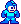
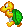
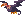
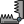

<p align="center">
  
</p>

<p align="center">
  
  
  
  
</p>

<p align="center">
  <b>Corré, saltá, golpeá y no pierdas las 3 vidas.</b><br>
  Un endless runner 2D hecho con Python y Pygame, con sprites animados, doble salto y dificultad creciente.
</p>

<p align="center">
  
  &nbsp;&nbsp;
  
  &nbsp;&nbsp;
  
  &nbsp;&nbsp;
  
</p>

---

## Jugar

```bash
git clone https://github.com/nelson-nunez/Arcade.git
cd Arcade
pip install pygame
python Main.py
```

> [!NOTE]
> Ejecutá `Main.py` desde la raíz del proyecto: los sprites y la fuente se cargan con rutas relativas (`Sprite/`, `Lib/Font/`).

## Controles

| Acción | Entrada |
|---|---|
| Saltar (presionar de nuevo en el aire: **doble salto**) | <kbd>Espacio</kbd> |
| Golpear al enemigo | <kbd>P</kbd> |
| Reiniciar tras perder | <kbd>R</kbd> |
| Pausar / reanudar | Clic en el botón **Play** |
| Subir la velocidad un 20 % | Clic en el botón **Hard** |

## Cómo se juega

1. Aparecen enemigos (tortuga verde, tortuga roja y volador) y trampas a intervalos aleatorios.
2. **Golpear** a un enemigo lo elimina; esquivarlo hasta que sale de pantalla también suma progreso. Tocarlo sin atacar o pisar una trampa te cuesta **una vida** (empezás con 3).
3. Cada **5 acciones** subís de nivel: el fondo y los enemigos aceleran un 5 % y aparece *Level Up!*.
4. Sin vidas aparece *Perdiste*; con <kbd>R</kbd> arrancás de nuevo.

## Estructura

```text
Main.py                 bucle principal, eventos, colisiones y HUD
Creditos.py             ficha del proyecto
Lib/
├─ Core/                Jugador, Enemigo, Trampa y CharacterInterface
├─ Var/                 Constantes (pantalla, rutas) y Var (estado del juego)
├─ Color/               paleta de colores
└─ Font/                fuente megaman_2.ttf
Sprite/                 animaciones del jugador, enemigos, fondo, iconos y trampa
GuiaTP/                 consignas del trabajo práctico (PDF y DOCX)
```

<details>
<summary><b>Detalles de diseño</b></summary>

- `Jugador`, `Enemigo` y `Trampa` implementan una interfaz común (`CharacterInterface`) con `dibujar`, `mover`, `ganar`, `perder` y `destruir`.
- El estado compartido (vidas, nivel, velocidad del fondo, listas de enemigos y trampas) vive en la clase `Var`.
- El fondo hace scroll infinito con dos copias de la imagen que se alternan.
- Ventana de 800×600 px; el juego corre con una pausa fija de 50 ms por cuadro.

</details>

## Contexto académico

Proyecto de la cursada de **Programación de Videojuegos / Programación 2** en la UAI (2024). Aplica diseño de niveles, estructuras de datos, manejo de entradas y salidas, y programación orientada a objetos.

**Autor:** Nelson Nuñez

## Licencia

TODO: el repositorio no incluye archivo de licencia; agregá uno si querés que otras personas puedan reutilizar el código.
